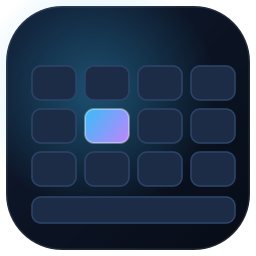
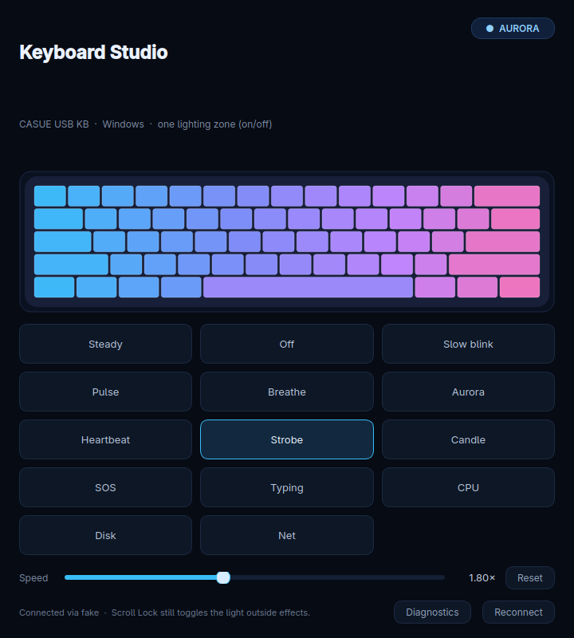

# Keyboard Studio



Lighting effects for the **CASUE USB KB** (`2A7A:959F`) on **Windows and Linux**
— 14 effects, a live preview, and a speed slider, built around the same hardware
limit: the strip is powered by the ScrollLock LED bit.



## Download

[](https://github.com/rmounikkumar/keyboard-studio-windows/releases/latest)

| Platform | Asset | Start with |
|---|---|---|
| Windows 10/11 | `Keyboard-Studio-1.0.1-win64.zip` | unzip, then run `Keyboard Studio\Keyboard Studio.exe` |
| Linux | `keyboard-studio-linux.zip` | unzip, then `cd linux && ./install.sh` |

Both are attached to the
[latest release](https://github.com/rmounikkumar/keyboard-studio-windows/releases/latest).
The Linux sources also live in [`linux/`](linux/README.md) in this repo.

### Windows

The Windows build is self-contained — no Python install, no installer, no admin
rights. It is a PyInstaller build of the source in this repo (`build-exe.bat`).

LED control goes through Windows' own **keyboard class driver**
(`IOCTL_KEYBOARD_SET_INDICATORS`), which is the same path Windows uses when it
updates the ScrollLock/NumLock/CapsLock lights. A HID output-report path remains
as a fallback. The app still **tests the driver itself** and tells you exactly
what happened — see [Diagnostics](#diagnostics).

### Linux

The Linux build is a small root service (`casue-kbd-backlight`) that owns the
ScrollLock bit, plus a PySide6 GUI and a `casue-kbd-effect` CLI:

```bash
unzip keyboard-studio-linux.zip
cd linux
./install.sh      # user pieces, then asks for the admin password once (pkexec)
```

Then open **Settings → Keyboard Studio**, or run `casue-kbd-effect aurora`.
Why it works, the mode table, the LED-bit proof and the uninstall steps are in
[`linux/README.md`](linux/README.md).

## The hardware limit is the same

The strip is powered by the ScrollLock LED bit. The keyboard exposes one
lighting zone and no colour channel, so effects are on/off patterns. The
wave/twinkle/colour animations come from the keyboard's own firmware.

## Run from source (Windows)

1. Install **Python 3.10+** from python.org (tick *Add python.exe to PATH*).
2. Double-click **`install.bat`** — installs `PySide6` and `psutil`.
3. Double-click **`run.bat`**.

No admin rights are needed: the keyboard class driver accepts the indicator
IOCTL from a normal user. If the light never changes, run `diagnose.bat` and
copy the report.

To build the standalone exe yourself, double-click **`build-exe.bat`** — the
result lands in `dist\Keyboard Studio\`.

## Install the build you made

The exe needs no installer, but copying it somewhere stable keeps the shortcut
pointing at a file you won't clean up by accident. Per-user, no admin:

1. Create `%LOCALAPPDATA%\Programs\Keyboard Studio`.
2. Copy everything from `dist\Keyboard Studio\` into it.
3. Right-click `Keyboard Studio.exe` → **Send to → Desktop (create shortcut)**,
   and/or **Pin to Start**.

After that, double-click **`update-installed.bat`** whenever you change the
source: it rebuilds with PyInstaller and mirrors the new build over the
installed copy, leaving your shortcuts alone.

To remove it again: delete the two shortcuts, the
`%LOCALAPPDATA%\Programs\Keyboard Studio` folder and `%APPDATA%\KeyboardStudio`.
No registry keys, services or drivers are created.

## What you should see

- Pressing **Scroll Lock** toggles the strip (Windows drives that LED itself, so
  it may work even with this app closed).
- Picking an effect in the app overrides that and animates the strip.
- Closing the app hands control back to Windows.

## Diagnostics

Double-click **`diagnose.bat`** (or run
`python keyboard_studio.py --diagnose`). It prints two sections:

**Keyboard interfaces (the path the app uses)** — the CASUE's own
`GUID_DEVINTERFACE_KEYBOARD` path, its HID usage, the indicator bits Windows
reports, and the result of turning ScrollLock off and on again. `accepted`
means the light is being driven successfully. The test leaves ScrollLock **on**
so you can confirm the light, and it lists how many other keyboards are present
(they are never touched).

The indicator read-back always says `0x0000` on this board, even while the LED
is lit, so the app tracks the ScrollLock state itself instead of trusting it.

**HID interfaces** — for every interface of this keyboard: interface path,
VID/PID, product string, usage page/usage, input/output/feature report lengths.
Collections that expose no output report are marked as skipped. The keyboard
collection shows `HidD_SetOutputReport` failing with error 1
(`ERROR_INVALID_FUNCTION`); that is expected on this board and is why the driver
path is used first.

If the class-driver line reports a failure, send that text back — the error code
says whether it was access denied (5), a missing device (2), or something else.
The **Diagnostics** button in the app shows the same report, and **Copy to
clipboard** is there for that reason.

## Known risks

- **Multiple keyboards.** The app opens the CASUE's own keyboard-device
  interface, so the indicator IOCTL lands on that keyboard only; a laptop's
  internal keyboard is never opened. Other keyboards are counted in Diagnostics
  but left alone.
- **LED fights.** Windows rewrites the lock indicators when the lock keys change.
  The app reads NumLock/CapsLock with `GetKeyState` and passes them through, and
  re-asserts the wanted ScrollLock bit once a second so a stray Scroll Lock press
  or a Windows update cannot leave the LED stuck.
- **Report layout (fallback only).** This board's HID keyboard collection
  advertises a 2-byte output report but rejects `HidD_SetOutputReport` with
  error 1, so the HID path is kept only for other machines. The driver path is
  the one that works here.
- **Lock-key side effect.** LEDs are set directly, so ScrollLock can be lit
  while Windows thinks ScrollLock is off. That is the same behaviour as the
  Linux version.

## Files

| file | purpose |
|---|---|
| `keyboard_studio.py` | the app (UI, effects, Windows stats) |
| `hidwin.py` | keyboard-class LED control, HID enumeration/fallback, diagnostics |
| `install.bat` | installs dependencies |
| `run.bat` | starts the app without a console |
| `diagnose.bat` | prints the driver report and waits |
| `build-exe.bat` | builds a standalone `Keyboard Studio.exe` with PyInstaller |
| `update-installed.bat` | rebuilds and copies the new build over the installed copy |
| `requirements.txt` | PySide6, psutil |
| `assets/keyboard.png`, `assets/keyboard.ico` | app icon (window + exe) |
| `tools/make_icon.py` | redraws the icon files |
| `linux/` | Linux build: systemd service, CLI, GUI, install/uninstall scripts |

## Effects

`steady`, `off`, `slow` (4 s on/off), `pulse`, `breathe`, `aurora`, `heartbeat`,
`strobe`, `candle`, `sos`, `typing`, `cpu`, `disk`, `net` — identical formulas
to the Linux service, so a mode looks the same on both systems.

`disk` and `net` need `psutil`; they are greyed out without it.
