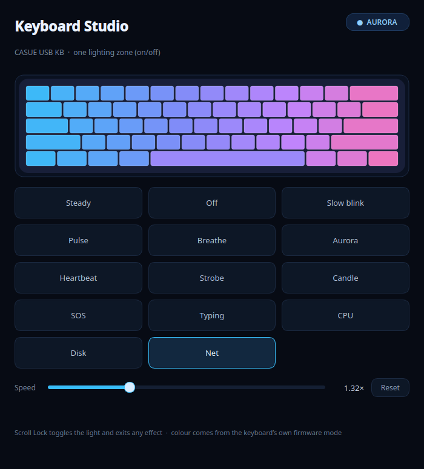

# Keyboard Studio — CASUE USB keyboard lighting for Linux

Controls the RGB strip on the **CASUE USB KB** (`2a7a:959f`) under Linux, and
gives you a GUI to pick and tune lighting effects.



Both platforms ship from the
[latest release](https://github.com/rmounikkumar/keyboard-studio-windows/releases/latest);
this folder is also downloadable there as `keyboard-studio-linux.zip`.

The honest constraint first: **this keyboard has one lighting zone and no colour
channel.** Its HID descriptor exposes only the standard LED report
(NumLock / CapsLock / ScrollLock / Compose / Kana) and two IN-only endpoints.
There is no vendor report and no OUT endpoint, so software can switch the whole
strip on or off — nothing more. Every "colour" and "wave" you see comes from the
keyboard's own firmware modes.

What that means in practice:

| You want | Possible? | How |
|---|---|---|
| Light on at all | yes | this project |
| Scroll Lock as an on/off switch | yes | this project |
| Blinking / breathing / pulse effects | yes | this project (one bit, toggled) |
| Rainbow wave, twinkle, fixed colours | firmware only | keyboard's own light / `Fn` combo |
| Per-key, chase, "one by one" lighting | no | needs addressable LEDs (different keyboard) |

## What's here

```
linux/
├── src/
│   ├── casue-kbd-backlight          root service: holds the LED state, runs effects
│   ├── casue-kbd-effect             CLI: pick an effect (no sudo)
│   ├── keyboard-studio              PySide6/Qt6 GUI
│   └── keyboard-studio-restore      reapplies your last choice at login
├── desktop/
│   ├── casue-kbd-backlight.service  systemd unit
│   ├── keyboard-studio.desktop      menu entry (Settings → Keyboard Studio)
│   └── keyboard-studio-restore.desktop   autostart entry
├── docs/
│   ├── keyboard-backlight.md        cause, fix, mode table, removal steps
│   ├── led-bit-sweep.txt            proof: only ScrollLock drives the strip
│   └── usb-descriptors.txt          proof: IN-only endpoints, no RGB report
└── screenshots/
    └── keyboard-studio.png
```

The Windows port lives at the top of this repository (`keyboard_studio.py`,
`hidwin.py`, the `.bat` helpers); its README is the [main one](../README.md).

## Windows

Same 14 effects, same one-bit hardware limit, packaged as a standalone
`Keyboard Studio.exe` — download the
[latest release](https://github.com/rmounikkumar/keyboard-studio-windows/releases/latest)
or read the [main README](../README.md). It drives the same ScrollLock bit
through `IOCTL_KEYBOARD_SET_INDICATORS` on the CASUE's own keyboard-device
interface, so a laptop's internal keyboard is never touched.

## Install

```bash
./install.sh      # run from this folder, or from the extracted release zip
```

(Cloned the repo instead? `cd linux` first, then run it.)

It installs the user-side pieces (GUI, CLI autostart entry, menu entry) without
a password, then asks for the admin password once via `pkexec` to install and
start the background service.

## Use

GUI: **Settings → Keyboard Studio**, or run `keyboard-studio`.

CLI:

```bash
casue-kbd-effect              # show current mode and list them all
casue-kbd-effect slow         # 4 s on / 4 s off
casue-kbd-effect aurora       # drifting swells
casue-kbd-effect steady       # back to plain on/off
```

Runtime state lives in two world-writable files so no sudo is ever needed:

- `/run/casue-kbd-effect` — current mode name
- `/run/casue-kbd-params` — `{"speed": 1.0}` (0.2 – 6.0)

The service recreates them at boot and re-reads them every loop.

## Effects

| mode | behaviour |
|---|---|
| `steady` | always on; Scroll Lock toggles (boot default) |
| `off` | stays dark |
| `slow` | 4 s on, 4 s off |
| `pulse` | 3.2 s swell |
| `breathe` | 1.6 s swell |
| `aurora` | layered sines, drifting 0.4–1.7 s swells, no fixed beat |
| `heartbeat` | double beat, 1.25 s cycle |
| `strobe` | 8 Hz flicker (photosensitivity warning) |
| `candle` | random soft flicker |
| `sos` | Morse `... --- ...` |
| `typing` | lit while you type, 1.2 s tail |
| `cpu` | blink duty follows CPU load |
| `disk` | flickers with storage activity |
| `net` | flickers with network activity |

Speed is a multiplier applied to the effect clock, so 2× makes every pattern
twice as fast. Scroll Lock always wins: in any effect it drops back to `steady`
with the light on, then keeps toggling.

## How it works

1. The firmware treats the **ScrollLock LED bit** as the strip's power switch.
   Linux never set it, so the light never came on.
2. `casue-kbd-backlight` writes `1` to the matching
   `/sys/class/leds/*::scrolllock/brightness` that resolves to `2A7A:959F`,
   finds it again after replug, and puts the bit back within ~0.1 ms whenever
   KDE rewrites the LED mask (Caps Lock / Num Lock) — that's why the light no
   longer flickers.
3. It reads the keyboard's `KEY_SCROLLLOCK` events directly, so Scroll Lock
   toggles the strip instead of only changing an LED state.
4. Effects are generated by toggling that single bit on a timer. A live preview
   in the GUI mirrors the same formulas.

## Uninstall

```bash
./uninstall.sh      # from this folder
```

Removes the service, binaries, menu/autostart entries and the log. Your saved
effect preference (`~/.config/keyboard-studio/state.json`) is removed too.
